# SixteeN

**A whole Super Nintendo console on your screen — not just a window with the
game.** SixteeN is a console-style frontend for the
[snes9x](https://www.snes9x.com/) emulator: a CRT TV, a console with a
cartridge slot and real POWER/RESET switches, and a shelf for your games, all
driven by mouse or gamepad. It runs on macOS, Windows, Linux and the Steam
Deck.

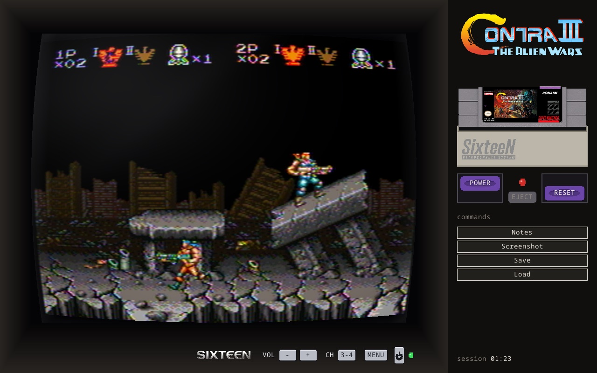

> SixteeN is **not a new emulator**. snes9x (the libretro core) runs the
> games; SixteeN is the console, the TV and the living room around it.
> It's a personal, non-commercial project.

**Website:** <https://ticianocorral.github.io/sixteen/> ·
**Download:** [latest release](https://github.com/ticianocorral/sixteen/releases/latest)

## What makes it different

Most frontends give you a grid of games and a window. SixteeN tries to give
you back the *object*: the console, the cartridge and the TV.

### The cartridge is a real cartridge

Picking a game on the shelf **inserts the cartridge**: it slides down into
the slot with a click, and the console only turns on when you press
**POWER**, just like the hardware. **EJECT** only works with the power off.
With no cartridge in, the TV sits on channel 3 static.

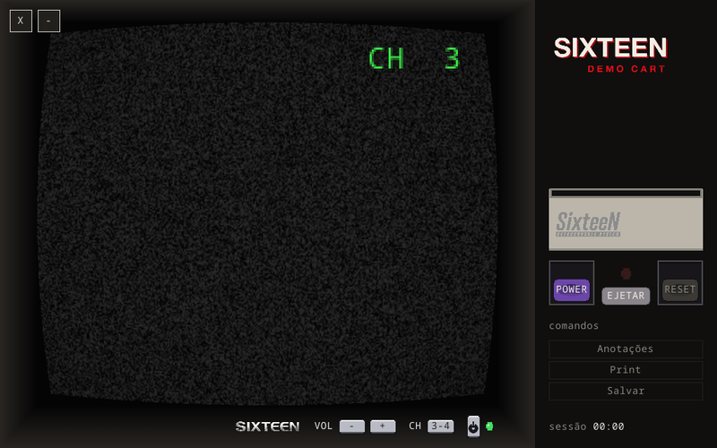

Optionally, cartridges can have a **bad contact** (`bad_contact`, off by
default): a black screen with a hum, garbage tiles built from the ROM's own
bytes, or the game running with scrambled graphics. Eject it, **blow on the
contacts** (hold the button — or blow into the real microphone on a Steam
Deck) and try again. Your save is never touched.

| A bad boot | Blowing the cartridge |
| --- | --- |
| 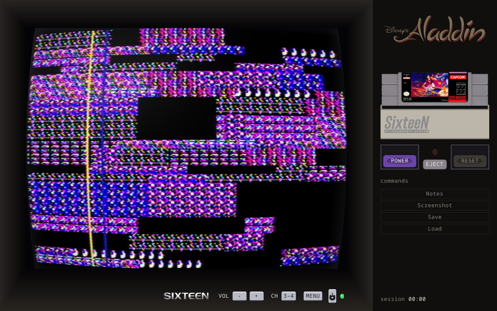 | 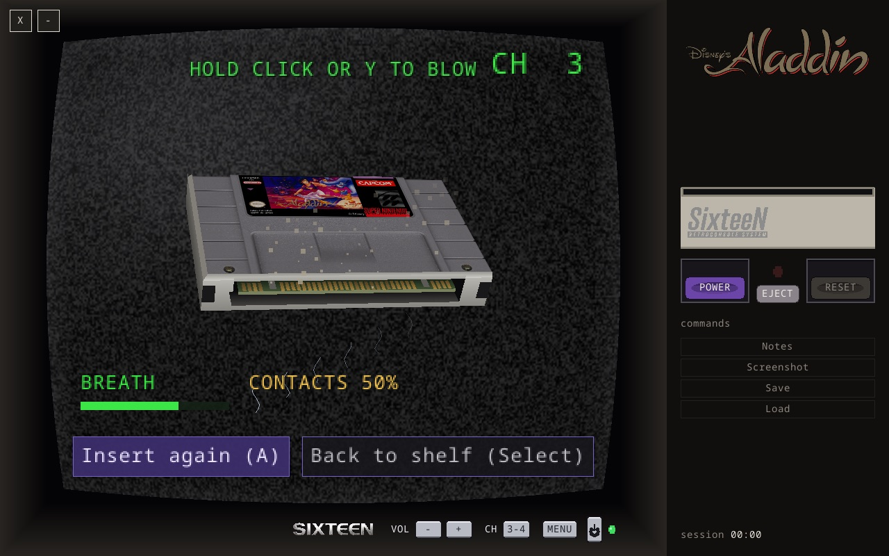 |

### A CRT you can pick

The picture goes through Blargg's NTSC filter, on a curved tube with its own
glass, glare and vignette. Pick a **screen look** — RF antenna (default),
Composite, S-Video, RGB / PVM, Trinitron, crisp LCD or black-and-white — and,
separately, the **scanlines and mask** (`screen_lines`) to mix and match. The
TV's own **MENU** button adjusts brightness, contrast, color and sharpness in
green 90s on-screen text, applied inside the real NTSC filter.

| RF antenna | RGB / PVM | Trinitron | Black & white |
| --- | --- | --- | --- |
| 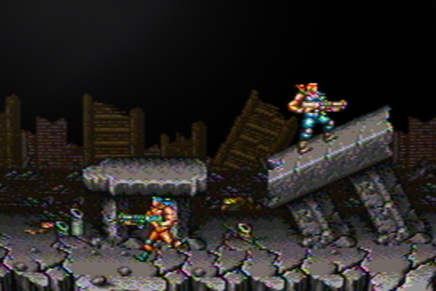 |  | 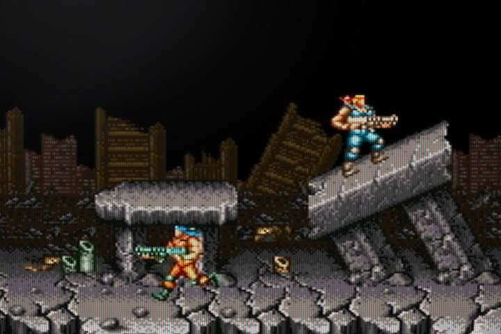 | 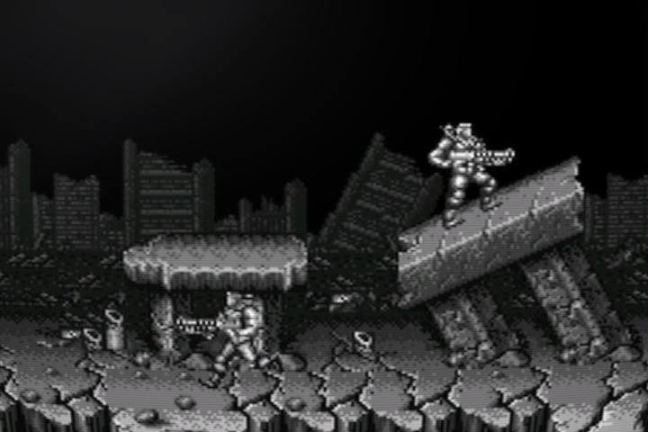 |

Small details, all optional: channel 4 really is the neighboring channel (a
weak, ghosting signal you can still play on), a faint **burn-in** after hours
on the same game, the flyback whine, the static hiss, and the **room light
following the time of day** on the TV glass.

### A shelf that's a piece of furniture

Your games stand on a real shelf with their boxes — and you choose the
furniture: **wood**, a **rental-store metal rack**, a **black hi-fi rack**, a
**90s bedroom** (Memphis wallpaper) or an **arcade** (neon and fluorescent
carpet). Games with no art become a grey cartridge with a **hand-written
label**.

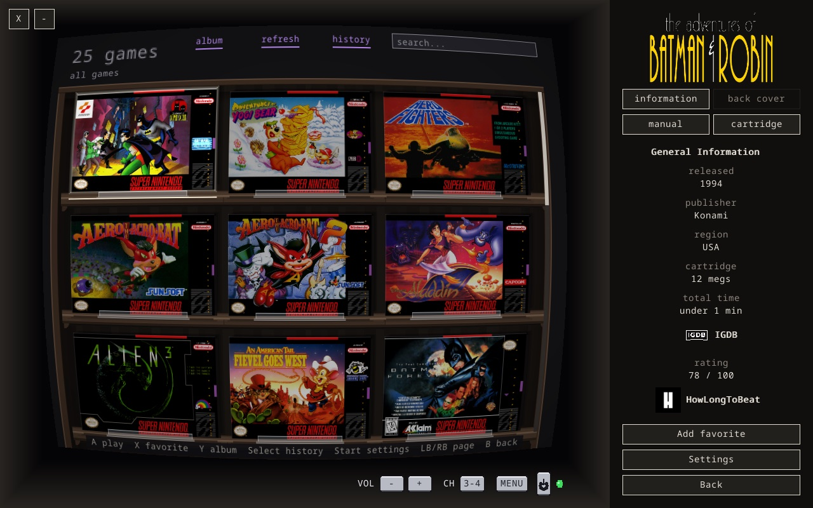

| Rental-store metal rack | 90s bedroom | Arcade |
| --- | --- | --- |
| 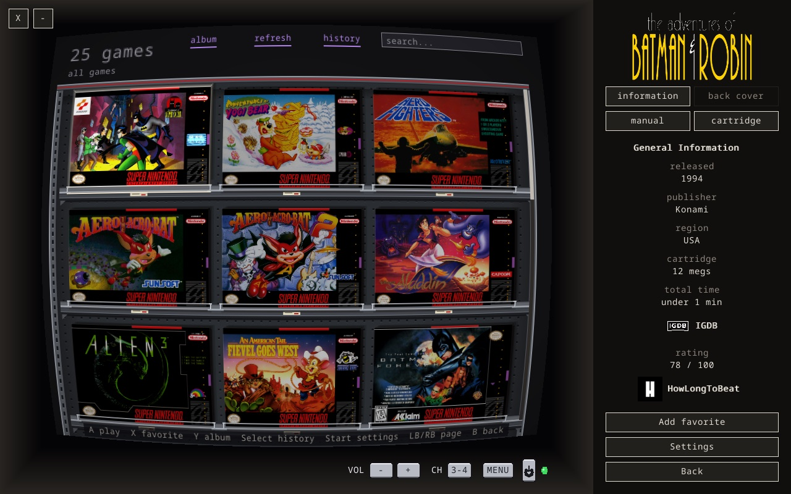 | 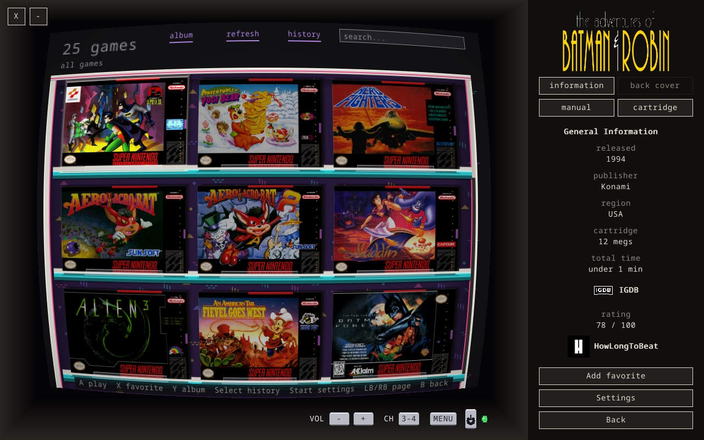 | 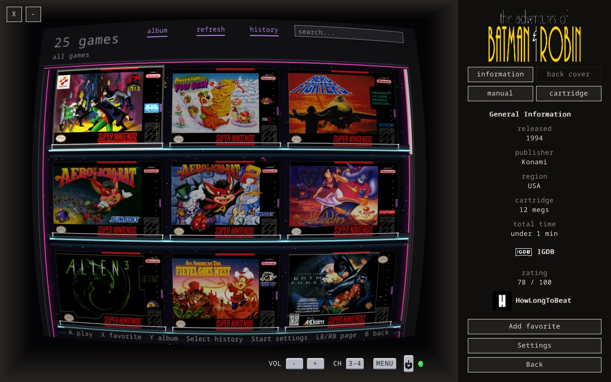 |

The side panel shows each game's year, publisher, region, cartridge size, play
time, **IGDB rating** and **HowLongToBeat** times, its back cover, its
cartridge and its **manual (PDF) paged inside the TV**. Search, favorites,
"recently played", history with play time per session, and an optional
**"tonight's pick"** that suggests a game you haven't touched in a while.

### Offline by design

- **No scraping, no account, no database server.** Year, publisher, region,
  ratings and HowLongToBeat times for 4,268 SNES games are built into the
  binary (from No-Intro, TOSEC, Wikidata and IGDB). Drop a ROM in and the
  info is there.
- Box art, logos, cartridges, back covers and manuals come from **your own
  image files**, named after the ROM.
- A local No-Intro DAT is optional; a button renames your ROMs to the
  No-Intro standard and moves saves, notes and art along with them.

### 100% gamepad (built for the Steam Deck)

Everything works with a controller — shelf, settings, achievements login,
screenshot captions — with an **on-screen keyboard** when you need to type.
In game, hold **Select + Start** for the game menu (save/load state,
screenshot, notes, achievements, reset, eject). The left stick works as the
D-pad. The controls screen draws a Super Nintendo pad and lights up what you
press, with Xbox, PlayStation or Nintendo button names, and players 1 and 2
each get their own mapping.

| Controls | On-screen keyboard |
| --- | --- |
| 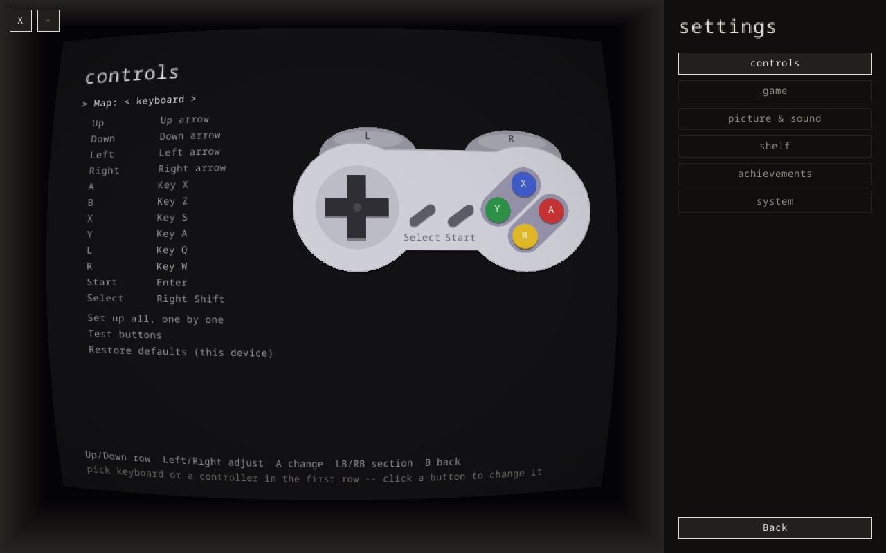 | 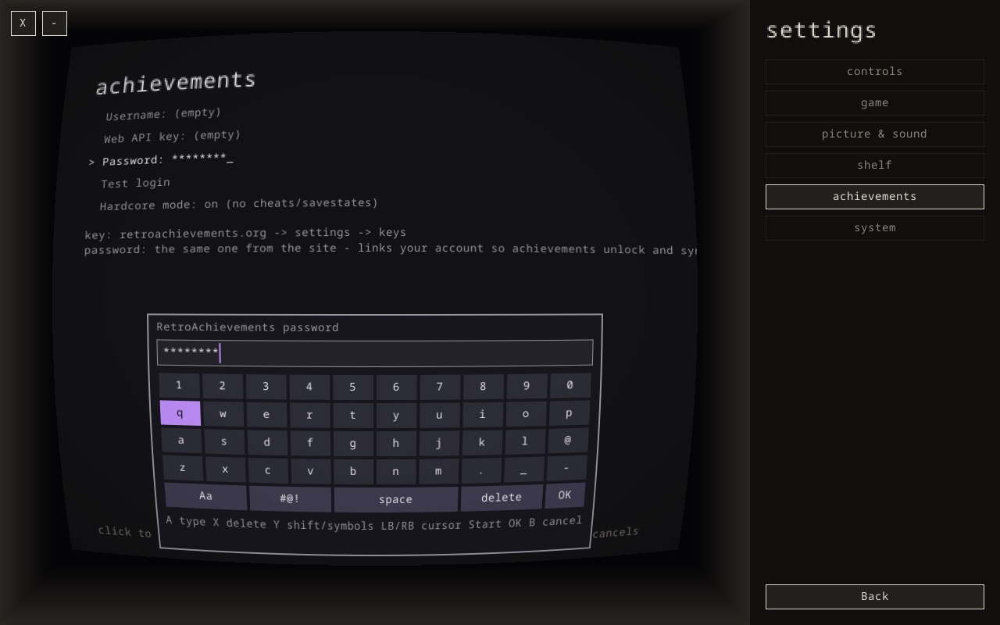 |

On the Steam Deck, SixteeN uses the native 1280×800 resolution and keeps
battery use low: still screens drop to 20–30 fps, a minimized window draws
nothing, and audio streams close when they're silent so the system can power
the output down.

### And more

- **Notes book**: pausing opens a two-page book — free-text notes and 15
  screenshot slots per game, which you can name and pin to the console panel.
- **Screenshot album** for all your games.
- **Cheat Genius**: a 90s-accessory-style cheat screen that runs before the
  game, with each game's cheat list, and a code pad for your own Game Genie
  and RAM codes.
- **[RetroAchievements](https://retroachievements.org)**: hardcore or
  softcore, unlocks on the TV's chin, progress on the shelf.
- **Console manual**: SixteeN's own 10-page manual, opened inside the TV.
- English and Brazilian Portuguese interface.

## Download

Ready-made packages, with SDL3 bundled, are built for every release:

| Platform | Package |
| --- | --- |
| macOS 12+ (Apple silicon) | `SixteeN-<version>-macos.dmg` |
| Windows 10+ (x86_64) | `SixteeN-<version>-windows-x86_64.zip` |
| Linux / Steam Deck (x86_64) | `SixteeN-<version>-linux-x86_64.AppImage` or `.flatpak` |

Get them from [Releases](https://github.com/ticianocorral/sixteen/releases/latest).

The builds aren't signed by Apple or Microsoft, so the first launch asks you
to confirm:

- **macOS:** open the app once, then go to *System Settings → Privacy &
  Security* and click **Open Anyway**.
- **Windows:** on the SmartScreen warning, click *More info* → **Run anyway**.

## Getting started

1. **Open SixteeN.** On first launch it creates its data folder:

   | Platform | Data folder |
   | --- | --- |
   | macOS | `~/Library/Application Support/SixteeN` |
   | Linux / Steam Deck | `~/.local/share/SixteeN` (`$XDG_DATA_HOME/SixteeN`) |
   | Linux (Flatpak) | `~/.var/app/dev.ticianocorral.sixteen/data/SixteeN` |
   | Windows | next to the `.exe` |

2. **Install the core.** With no core installed, the home screen offers to
   **download the snes9x core** (also in *Settings*), straight from the
   libretro buildbot and checked with SHA-256. SixteeN keeps it up to date.
3. **Add your games.** Put your `.sfc` / `.smc` / `.zip` ROMs in `roms/`.
4. **Add art (optional).** Drop a `<rom name>.png` — same name as the ROM,
   without the extension — into `assets/cover/`, `assets/logo/`,
   `assets/cartridge/` or `assets/backcover/`, and a `<rom name>.pdf` into
   `assets/manual/`. The [website](https://ticianocorral.github.io/sixteen/)
   lists community art packs.

SixteeN doesn't ship any ROM, BIOS, core or game art. Your games are yours.

## Building from source

You need stable Rust and SDL3.

```bash
brew install sdl3   # macOS
cargo build && cargo test
cargo run --bin sixteen
```

Without SDL3 installed, build it along (needs CMake and a C toolchain):

```bash
cargo build --features sixteen-platform/vendored-sdl
```

`emu-run` runs a single ROM without the rest of the app:

```bash
cargo run --bin emu-run -- --core path/to/snes9x_libretro.dylib --rom game.sfc
```

### Architecture

Four layers; dependencies only point down.

| Layer | Crate | Responsibility |
| --- | --- | --- |
| Presentation | `sixteen-app` | binaries (`sixteen`, `emu-run`, `selector`), the game loop, shelf, settings |
| Domain | `sixteen-domain` | ROM identification, catalog, No-Intro DAT, built-in game info, cheats |
| Emulation | `sixteen-emulation` | libretro core loaded at runtime, run loop |
| Platform | `sixteen-platform` | SDL3: the cabinet (TV, CRT tube, console panel), audio, gamepads |

`sixteen-ntsc` is a separate leaf crate (Blargg's `snes_ntsc`, vendored) and
`sixteen-ra` holds the RetroAchievements client. The technical manual is in
[`docs/manual-tecnico.md`](docs/manual-tecnico.md) (Portuguese).

## Versioning and licenses

[SemVer 2.0.0](https://semver.org/): the whole workspace shares one version,
each release is a `vX.Y.Z` tag with an entry in
[`CHANGELOG.md`](CHANGELOG.md) (Portuguese).

SixteeN is [MIT-licensed](LICENSE). snes9x has its own **non-commercial**
license, which is why the core is never bundled and SixteeN stays
non-commercial. Third-party licenses are in
[`THIRD-PARTY-NOTICES.md`](THIRD-PARTY-NOTICES.md).
RetroAchievements is a third-party service and needs its own account.
